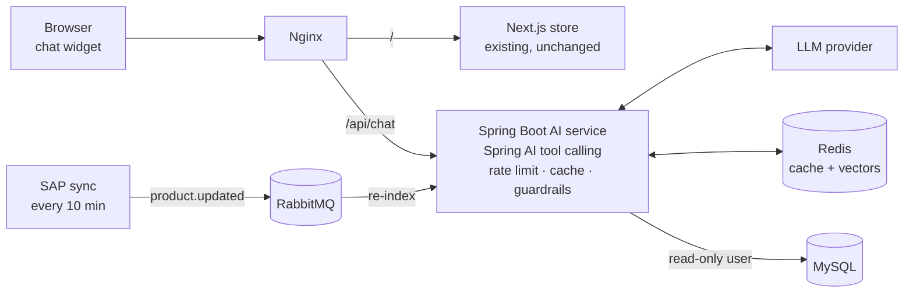
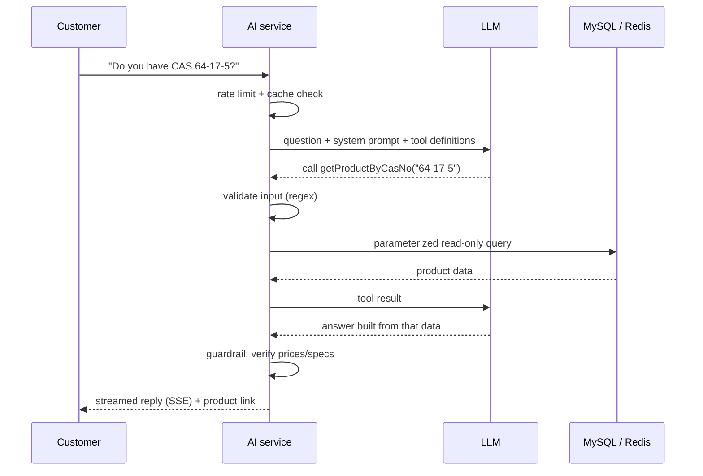

# Spring AI Catalog Assistant

> An LLM-powered product and COA assistant for a live B2B chemicals e-commerce site, built as a Spring Boot microservice with **tool calling, hybrid vector search, RAG over COA PDFs, guardrails and an automated evaluation suite.**

**Live on:** [kaarislabs.com](https://kaarislabs.com) <!-- add a demo GIF here once the widget is live -->

<!-- Replace every [bracketed] value with a number you measured. Tick roadmap items only when they are done. -->

---

## What it does

Customers ask questions in plain language and get answers built **only from real catalogue and COA data**, with links to the source.

| Customer asks | Assistant does |
|---|---|
| "Do you have CAS 64-17-5 in 500 ml?" | Exact CAS lookup → pack sizes, stock, product link |
| "What's the purity on the COA for batch KL-2391?" | Retrieves that batch's COA → answers with the value and the PDF link |
| "Solvent for HPLC under ₹2000, in stock" | Hybrid search with filters → ranked product list |
| "Where's my order #1042?" | Order status, only for the logged-in owner |

## Architecture



The AI service is isolated from the store: slow or failed LLM calls never affect the website, and it scales and deploys independently.

## How a request works



## Key design decisions

**Tool calling instead of text-to-SQL.** The LLM never writes SQL. It can only call Java methods I wrote, validated and scoped to a read-only database user. A prompt-injection attempt can, at worst, call an existing safe function.

**Hybrid search.** CAS and catalogue numbers must match exactly, since a "similar" CAS number is a different chemical. Identifiers are detected by regex and routed to exact match; natural-language queries go to vector search. Results are merged.

**RAG over COA PDFs with metadata filtering.** COAs are parsed (Apache PDFBox), chunked by test-parameter section and tagged with catalogue and batch number. Retrieval filters by batch **before** vector search, so another batch's values can never be used.

**Guardrails in code, not just in the prompt.** Any price or percentage in a reply is checked against that turn's tool results. Unverified figures trigger a safe fallback.

**Event-driven re-indexing.** The existing SAP sync publishes product updates to RabbitMQ; a consumer re-embeds only the changed products, with retries and a dead-letter queue.

## Tools exposed to the LLM

| Tool | Purpose |
|---|---|
| `searchProducts(query, filters)` | Hybrid product search with price, category and stock filters |
| `getProductByCasNo(casNo)` | Exact lookup by CAS number |
| `getProductByCatNo(catNo)` | Exact lookup by catalogue number |
| `getCoa(catNo, batchNo)` | COA link and matching COA content |
| `getOrderStatus(orderId)` | Order status; user id taken from the verified JWT, never from chat text |

## Production engineering

- **Streaming:** replies streamed over Server-Sent Events.
- **Caching:** Redis answer cache (short TTL, evicted on product updates) and embedding cache.
- **Resilience:** timeouts, retries with backoff, and a circuit breaker (Resilience4j) that falls back to plain search results.
- **Cost control:** per-request token limits, daily budget cap, rate limiting with Bucket4j.
- **Observability:** structured log per turn (latency, tokens, cost, tools called, cache hit), metrics via Spring Actuator + Micrometer.
- **Data access:** Hibernate `@Immutable` entities, read-only transactions, DTO projections, `@EntityGraph` to avoid N+1 queries.
- **Parallel indexing:** bulk embedding of products and COAs with a bounded thread pool.

## Evaluation

A suite of **[100]** real customer-style questions (CAS lookups, COA values, vague searches, out-of-stock items, off-topic and prompt-injection attempts) runs in CI on every change.

| Metric | Value |
|---|---|
| Answer accuracy | [X]% |
| Tool selection accuracy | [X]% |
| Hallucination rate (unverified figures) | [X]% |
| p95 latency (first token / full reply) | [X] s / [Y] s |
| Cache hit rate | [X]% |
| Avg. cost per 1,000 queries | [X] |

**Accuracy history:** exact search only [X]% → hybrid search [Y]% → + COA RAG [Z]%

## Project structure

```
src/main/java/.../assistant
├── chat/          # REST + SSE endpoint, conversation handling
├── tools/         # @Tool methods exposed to the LLM
├── search/        # exact, semantic and hybrid search strategies
├── rag/           # COA parsing, chunking, retrieval
├── guardrails/    # input validation and output verification
├── indexing/      # embedding pipeline + RabbitMQ consumers
├── config/        # Spring AI, Redis, security, rate limits
└── observability/ # per-turn logging and metrics
src/test/java/...  # JUnit 5, Mockito, MockMvc tests + eval suite
```

## Running locally

```bash
cp .env.example .env    # add your LLM API key and database settings
docker compose up -d    # starts the service, Redis and RabbitMQ
```

Then send a test question:

```bash
curl -N -X POST localhost:8080/api/chat \
  -H "Content-Type: application/json" \
  -d '{"message": "Do you have CAS 64-17-5?"}'
```

## Roadmap

**MVP**
- [ ] Spring AI tool calling with exact product search and COA links
- [ ] System prompt, input validation, rate limiting
- [ ] Next.js chat widget with SSE streaming
- [ ] Docker + Nginx deployment, Redis answer cache

**v2**
- [ ] Product embeddings and hybrid search
- [ ] RAG over COA PDFs with batch-level filtering
- [ ] Order status with JWT ownership check
- [ ] Output guardrail for prices and specs
- [ ] 100-question evaluation suite

**v3**
- [ ] RabbitMQ event-driven re-indexing with dead-letter queue
- [ ] Resilience4j circuit breaker with search fallback
- [ ] Metrics dashboard and cost tracking
- [ ] Evaluation suite in GitHub Actions CI

## Tech stack

Java 21 · Spring Boot 3 · Spring AI · Spring Data JPA / Hibernate · Spring Security (JWT) · Redis (vector search + cache) · RabbitMQ · MySQL · Apache PDFBox · Resilience4j · Bucket4j · JUnit 5 · Mockito · Docker · Nginx · GitHub Actions
